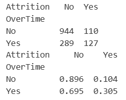
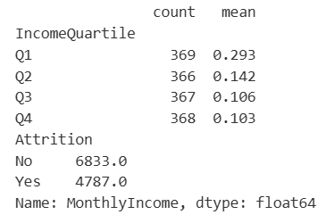
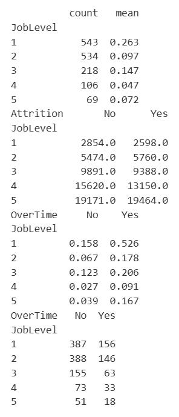

# Python 7주차 프로젝트 과제

이번 주 목표는 **지금까지 진행한 분석을 최종 리포트로 완성하는 것**입니다.  
새로운 분석을 무리하게 추가하기보다, 기존 결과를 논리적으로 정리하세요.

**필수:** 본인의 노트북에서 진행한 코드, 표, 그래프 결과를 정리하고 주요 진행 과정을 스크린샷으로 첨부해주세요.  
👀 수행 인증샷은 필수입니다.

노트북은 반드시 위에서 아래로 순서대로 실행해주세요. 중간 셀만 실행하면 이전에 만든 변수가 없어 오류가 날 수 있습니다.

---

## 참고 교재

- 『파이썬 라이브러리를 활용한 데이터 분석』
  - 5장~10장 중 본인 프로젝트에 필요한 부분

---

## 이번 주 과제 목차

| 구분 | 내용 |
| --- | --- |
| 필수 1 | 문제 정의 |
| 필수 2 | 데이터 소개 |
| 필수 3 | 분석 과정 |
| 필수 4 | 핵심 인사이트 |
| 필수 5 | 한계점과 결론 |
| 선택 | 발표용 요약 |

---

<br>

<!-- 여기까진 그대로 둬 주세요-->

---

# 1️⃣ 최종 리포트

## 1. 문제 정의

프로젝트가 어떤 질문에서 시작했는지 정리하세요.

```md
분석 주제: IBM HR 데이터를 활용한 직원 이직 요인 분석
분석 질문: 초과근무, 소득, 직급 같은 근무 조건 중 어떤 것이 직원의 이직과 가장 밀접하게 연관되어 있는가?
이 질문이 중요한 이유: 이직은 채용과 교육 비용 손실로 이어지기 때문에, 이직 위험이 높은 집단을 미리 파악하면 인사 관리에서 먼저 살펴볼 대상을 정할 수 있다
```

## 2. 데이터 소개

사용한 데이터셋과 주요 컬럼을 설명하세요. 2주차 데이터 명세서를 활용하면 됩니다.

```md
데이터셋 이름: IBM HR Analytics Employee Attrition & Performance
데이터 출처: https://www.kaggle.com/datasets/pavansubhasht/ibm-hr-analytics-attrition-dataset
행과 열 개수: 1470행 35열 (숫자형 26개, 문자형 9개). 결측치와 중복 행은 없다
주요 컬럼: Attrition(이직 여부, 분석의 기준 변수), OverTime(초과근무 여부), MonthlyIncome(월 소득), JobLevel(직급 1~5), Department(부서), Age(나이), JobSatisfaction(직무 만족도), WorkLifeBalance(워라밸 만족도), TotalWorkingYears(총 경력), YearsAtCompany(현 회사 근속 연수)
```

## 3. 분석 과정

2~6주차에 수행한 내용을 짧게 정리하세요. 각 항목은 길게 쓰지 않아도 되고, 1-2문장이면 충분합니다.

```md
전처리: isna()와 duplicated()로 확인한 결과 결측치와 중복이 모두 0개여서 별도 처리하지 않았다. MonthlyIncome 상위 10개 값도 확인했는데 입력 오류가 아닌 고경력 직원의 정상적인 값이라 그대로 두었다
EDA: 이직자는 237명으로 전체의 16.1%여서 이직 여부의 비율이 한쪽으로 치우쳐 있다. 총 경력 분포, 경력과 소득의 산점도, 초과근무 여부별 이직 비율을 확인했다
파생변수: 월 소득을 연 단위로 환산한 IncomePerYear와, 전체 경력 중 현재 회사 근속 비율인 TenureRatio를 만들었다. 총 경력이 0년인 11명은 TenureRatio가 계산되지 않아 NaN으로 남는다
그룹별 분석: 부서별 평균 월 소득은 Sales, Human Resources, Research & Development 순으로 높았고, 부서와 이직 여부를 함께 본 피벗 테이블에서는 모든 부서에서 이직자의 평균 소득이 낮았다
시각화: 초과근무 여부별 이직률 막대그래프, 이직 여부별 소득 분포 히스토그램, 나이와 소득의 산점도를 그렸다. 선택 과제로 같은 부서별 소득 데이터를 세로와 가로 막대그래프로 비교했다
```

## 4. 핵심 인사이트

최종 리포트에서 가장 중요하다고 생각하는 결과를 3개 정리하세요. 표나 그래프를 근거로 함께 제시하세요.

```md
인사이트 1: 초과근무를 하는 직원의 이직률이 훨씬 높고, 이 차이는 직급을 나눠도 유지된다
근거: 초과근무를 하는 그룹의 이직률은 30.5%(416명 중 127명)로 하지 않는 그룹의 10.4%(1054명 중 110명)보다 약 3배 높다. 직급별로 나눠 봐도 5개 직급 모두에서 초과근무 그룹의 이직률이 더 높았다


인사이트 2: 월 소득이 가장 낮은 구간에서 이직률이 눈에 띄게 높다
근거: 소득을 4구간으로 나누면 하위 25%(월 1009~2911)의 이직률이 29.3%이고, 나머지 구간은 14.2%, 10.6%, 10.3%이다. 이직자의 평균 월 소득도 4787로 재직자의 6833보다 낮다


인사이트 3: 소득과 이직의 관계는 상당 부분 직급 효과가 섞여 있고, 초급 직급과 초과근무가 겹치는 집단의 이직률이 가장 높다
근거: JobLevel 1의 이직률은 26.3%(543명 중 143명)이고 나머지 직급은 4.7~14.7%이다. 같은 직급 안에서 보면 이직자와 재직자의 소득 차이는 작거나(JobLevel 1은 2598 대 2854) 오히려 이직자가 더 높았다(JobLevel 2, 5). JobLevel 1이면서 초과근무를 하는 집단의 이직률은 52.6%(156명 중 82명)로 가장 높다

```

## 5. 한계점과 결론

분석 결과를 과장하지 않도록 데이터의 한계와 후속 분석 방향도 함께 적으세요.

```md
데이터의 한계: Kaggle 설명 기준으로 IBM이 만든 가상 데이터라 실제 기업의 결과로 그대로 일반화하기 어렵다. 특정 한 시점의 데이터라 이직이 언제, 어떤 순서로 일어났는지 알 수 없고, 이직자가 237명뿐이라 소집단은 표본이 작다
분석의 한계: 평균과 비율을 비교하는 방식이라 차이가 우연인지 확인하는 통계 검정을 하지 않았다. 변수를 한두 개씩만 교차해서 봤기 때문에 다른 변수의 영향을 동시에 통제하지 못했다. 또 상관관계만 확인했을 뿐이라 초과근무가 이직의 원인인지, 이직을 생각하는 사람이 초과근무를 하는 건지는 알 수 없다
분석 질문에 대한 최종 답변: 이 데이터에서 이직과 가장 뚜렷하게 연관된 조건은 초과근무와 초급 직급(JobLevel 1)이다. 초과근무는 모든 직급에서 이직률이 높았고, 소득이 낮을수록 이직이 많아 보이는 현상은 상당 부분 초급 직급의 영향으로 보인다. 
추가로 해보고 싶은 분석: 카이제곱 검정 등으로 이직률 차이가 통계적으로 의미 있는지 확인하고, 로지스틱 회귀나 의사결정나무로 초과근무와 직급, 소득을 함께 넣어 각 변수의 영향을 비교하고 싶다. 직무 만족도와 워라밸이 초과근무와 이직 사이에서 어떤 역할을 하는지도 살펴보고 싶다
```

---

# 2️⃣ 선택 과제

최종 리포트를 5문장 이내로 요약해보세요. 발표나 공유 자료를 만들 때 사용할 수 있습니다.

```md
프로젝트 한 줄 요약: IBM HR 데이터로 직원 이직과 연관된 근무 조건을 살펴본 분석
핵심 결과 요약: 초과근무를 하는 직원의 이직률은 30.5%로 하지 않는 직원(10.4%)의 약 3배이고 모든 직급에서 같은 방향이다. 소득 하위 25%의 이직률도 29.3%로 높지만, 같은 직급 안에서는 이직자와 재직자의 소득 차이가 작아 직급 효과가 크게 섞여 있다. 초급 직급(JobLevel 1)이면서 초과근무를 하는 집단의 이직률은 52.6%로 가장 높다. 다만 가상 데이터이고 인과관계를 확인할 수 없어 경향 수준으로 해석해야 한다
```

---

# 3️⃣ 제출 체크리스트

- [v] 문제 정의를 작성했다.
- [v] 데이터 출처와 데이터 설명을 작성했다.
- [v] 분석 과정을 정리했다.
- [v] 핵심 인사이트 3개를 작성했다.
- [v] 표 또는 그래프를 근거로 제시했다.
- [v] 한계점과 최종 결론을 작성했다.

🎉 수고하셨습니다.  
이번 Python 트랙을 통해 데이터 선정부터 최종 리포트 작성까지 개인 분석 프로젝트의 전체 흐름을 완성했습니다.
